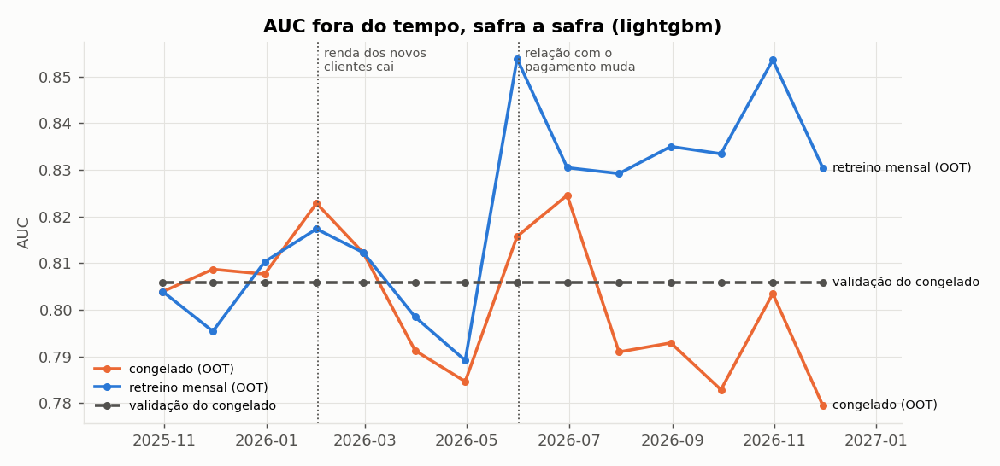
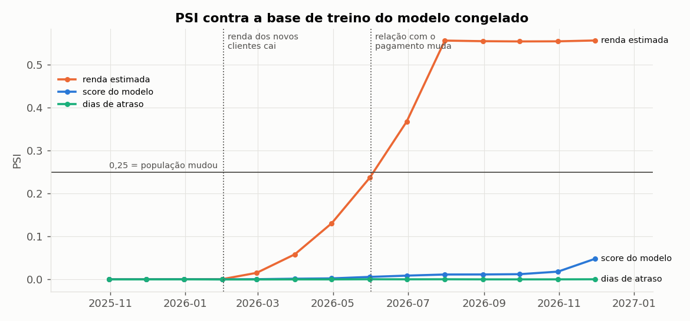
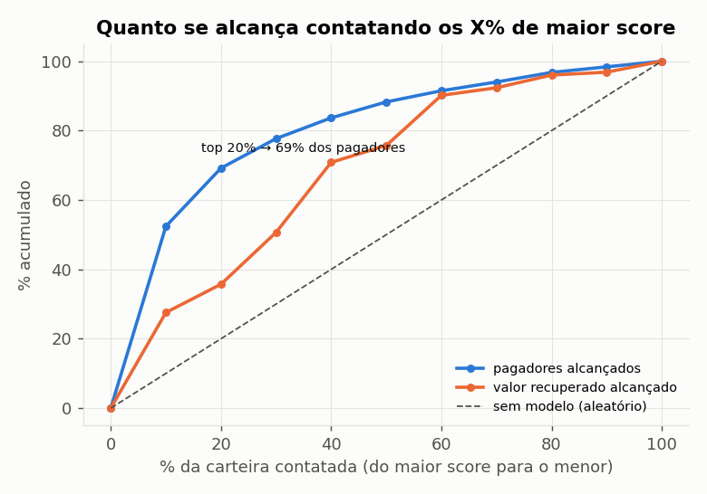

# Propensão a pagamento em cobrança

Modelo que ordena os contratos de uma carteira de cobrança pela chance de pagar nos próximos 30 dias. Ele define quem a operação contata primeiro quando não há capacidade para falar com todos, e mostra como validar, monitorar e retreinar esse modelo ao longo do tempo.

> **Todos os dados são sintéticos**, gerados por [`dados/gerar_carteira.py`](dados/gerar_carteira.py) (seed 42). Nenhum dado real de cliente ou de empresa.

## Contexto

Este projeto reproduz, com dados sintéticos, decisões que tomei num projeto real de propensão a pagamento numa assessoria de cobrança:
- como montar a base sem olhar o futuro;
- como comparar modelos com validação fora do tempo;
- como transformar o score em fila de trabalho;
- como perceber que um modelo em produção está envelhecendo.

O código foi escrito do zero. Os números abaixo vêm só do dado sintético.

## Problema de negócio

Uma assessoria recebe contratos inadimplentes e trabalha cada um por cerca de 180 dias. Tem mais contratos do que operadores, linhas e disparos.

**Pergunta:** em cada data de referência D, quais contratos da carteira têm mais chance de pagar algo até D + 30 dias?

## Dados

- **Tabelas:** 5 (clientes, contratos, acionamentos, acordos, pagamentos).
- **Volume:** cerca de 27 mil contratos e 250 mil tentativas de contato, de jan/2025 a dez/2026.
- **Safras:** 17 safras mensais, de jul/2025 a nov/2026, com cerca de 6.800 contratos ativos cada.
- **Taxa de pagamento em 30 dias:** entre 4% e 7%. A base é desbalanceada, como na vida real, por isso acurácia não serve.
- **Sujeiras de propósito:** UF bagunçada, nulos, linhas duplicadas e data em texto `dd/mm/aaaa`.
- **Mudança de cenário em duas etapas**, para o monitoramento ter o que detectar:
  1. **fev/2026:** entram clientes com renda menor. Muda a *população*.
  2. **jun/2026:** muda a *relação* entre as variáveis e o pagamento. O efeito da renda se inverte e o atraso pesa mais.

## Método

| Etapa | O que foi feito | Onde |
|---|---|---|
| Base *as-of* | As features usam só eventos anteriores a D. O alvo fica em (D, D+30]. Há testes de grão, de "não olhar o futuro" e de alvo | [`src/base_analitica.py`](src/base_analitica.py) |
| A base em SQL | As features de histórico de contato e o alvo, com CTEs, `ROW_NUMBER` para deduplicar e `SUM(CASE…)`. Um teste confere que essas colunas batem com o Python | [`sql/base_analitica.sql`](sql/base_analitica.sql) |
| Modelos | Regressão logística (benchmark), LightGBM e uma rede MLP, no **mesmo** `Pipeline` + `ColumnTransformer` | [`src/modelos.py`](src/modelos.py) |
| Backtest fora do tempo | A cada mês: treina nas 3 safras anteriores com alvo já fechado e testa no mês seguinte. Compara o modelo **congelado** com o **retreinado todo mês** | [`src/backtest.py`](src/backtest.py) |
| Métricas | AUC, Gini, KS, PR-AUC e captura no top 20%, além de PSI para monitoramento | [`src/avaliar.py`](src/avaliar.py) |
| Operação | Faixas em pirâmide (Diamante/Ouro/Prata/Bronze) dentro de cada faixa de atraso e simulação de capacidade | [`src/faixas.py`](src/faixas.py) |

## Resultados

### 1. Os três modelos ordenam praticamente igual

Média das safras de teste antes da mudança de jun/2026, com retreino mensal ([`relatorios/comparacao_modelos.csv`](relatorios/comparacao_modelos.csv)):

| Modelo | AUC | KS | PR-AUC | Captura no top 20% | Treino (s) |
|---|---|---|---|---|---|
| Regressão logística | **0,819** | **0,535** | 0,241 | **69,6%** | **0,05** |
| MLP (rede neural) | 0,812 | 0,532 | 0,251 | 68,9% | 0,63 |
| LightGBM | 0,810 | 0,532 | **0,286** | 68,7% | 0,23 |

Contatando só os 20% de maior score, a operação alcança perto de 70% de quem vai pagar.

### 2. A validação não é a produção

Os gráficos de tempo usam o LightGBM, onde o efeito aparece mais forte.



- **Até mai/2026:** o LightGBM congelado acompanha o retreinado (AUC média 0,806 contra 0,810).
- **Depois de jun/2026:** a relação com o pagamento muda. O congelado cai para 0,790 e fica de 3,8 a 5,1 pontos abaixo do retreinado (0,836).
- **O que engana:** a AUC de validação do congelado continua dizendo 0,806, e quem olha só esse número não vê a queda.
- **O efeito do retreino:** com a mesma janela de 3 safras, o retreino mensal absorve a mudança em um mês.

### 3. O PSI viu a mudança de população, não a de relação



- **A mudança de população (fev/2026)** aparece no PSI da renda: ele passa de 0,25 em mai/2026 e chega a 0,6. Mesmo assim, o modelo continuou ordenando bem. Para o desempenho, esse alarme foi **falso**.
- **A mudança de relação (jun/2026)**, que é a que derrubou a AUC, **não aparece em nenhum PSI**: o do score fica abaixo de 0,03 e o dos dias de atraso perto de zero. As variáveis continuaram com a mesma distribuição; o que mudou foi o que elas significam.
- **Só o backtest fora do tempo pegou essa mudança.** Ele depende do alvo, que só fecha 30 dias depois, então o monitoramento de desempenho sempre chega com atraso.
- Lição: o PSI alto manda **investigar**, não retreinar. O gatilho de retreino é a queda de desempenho fora do tempo.

### 4. Do score à fila de trabalho



Com capacidade para contatar uma parte da carteira na última safra (nov/2026, regressão logística retreinada, o modelo escolhido — [`relatorios/estrategias.csv`](relatorios/estrategias.csv)). As faixas de atraso são 0–360, 361–720, 721–1.080 e mais de 1.080 dias, porque esta carteira é de dívida antiga:

| Capacidade | Ranking único pelo score | Pirâmide por faixa de atraso (Diamante → Bronze) |
|---|---|---|
| 20% da carteira | 69% dos pagadores · 44% do valor | 66% dos pagadores · 43% do valor |
| 30% da carteira | **80%** dos pagadores · 63% do valor | 70% dos pagadores · 48% do valor |
| 50% da carteira | 91% dos pagadores · 91% do valor | 85% dos pagadores · 59% do valor |

- **A pirâmide tem custo:** a 30% de capacidade, ela alcança 11 pontos a menos de pagadores que o ranking único. Ela vale quando cada faixa de atraso tem a sua equipe, porque toda equipe recebe uma fila ordenada. Com fila única, o ranking global é melhor.
- **O valor anda atrás dos pagadores:** dívidas grandes pagam menos. Se a meta é valor recuperado, o próximo passo é um alvo em R$, como valor esperado = probabilidade × valor.
- **A tabela por faixa mostra taxa e participação** ([`relatorios/faixas.csv`](relatorios/faixas.csv)). Uma faixa grande pode somar mais pagadores com taxa menor. Olhar só um dos dois leva a concluir que "o modelo está invertido" quando não está.

## Decisão

- **Em produção vai a regressão logística.**
  - Ela empata ou supera os outros em AUC, KS e captura, treina em 0,05 s e cada coeficiente se explica para a operação.
  - É também a mais estável quando o cenário muda: congelada, fica só 1–2 pontos abaixo da retreinada depois de jun/2026, contra 4–5 do LightGBM.
- **O LightGBM fica como desafiante.** Ele tem a melhor PR-AUC (0,286), ou seja, acerta mais no topo da fila. Vale se a capacidade de contato for muito pequena.
- **A rede neural não entra.** Não ganha em nada e custa mais de 10 vezes mais para treinar que a logística. Em dado tabular com poucas variáveis, deep learning raramente se paga.
- **Ressalva honesta:** o gerador sintético usa uma relação logística por trás, o que favorece a logística. Em dado real, com interações que ninguém programou, o GBM costuma ganhar mais espaço. O método de comparação é o que este projeto quer mostrar, não o vencedor.

## Monitoramento e quando retreinar

| Sinal | Limite | Ação |
|---|---|---|
| PSI de feature ou do score | > 0,10 | Atenção: acompanhar |
| PSI de feature ou do score | > 0,25 | **Investigar** o que mudou na carteira (política, mix, canal) |
| AUC ou KS fora do tempo (chega 30 dias depois, quando o alvo fecha) | Queda > 3 pontos por 2 safras seguidas | **Retreinar** com a janela mais recente |

Além do gatilho, o retreino mensal com janela curta é a defesa contra a mudança de relação, que nenhum PSI enxerga.

## Como rodar

```bash
pip install -r requirements.txt
python dados/gerar_carteira.py      # gera a carteira sintética (~5 s)
python -m src.treinar               # backtest, gráficos e tabelas em relatorios/ (~30 s)
python -m pytest                    # 34 testes
```

Opcional: com `pip install mlflow`, o `src.treinar` registra cada modelo e modo no MLflow, e o `mlflow ui` mostra a comparação.

Com Docker: `docker build -t propensao . && docker run --rm -v "$PWD/relatorios:/app/relatorios" propensao`.

## Estrutura

```
dados/gerar_carteira.py      gerador sintético (24 meses, duas mudanças de cenário)
sql/base_analitica.sql       a base em SQL (estilo PostgreSQL, roda em SQLite)
src/                         base, modelos, métricas, backtest, faixas e orquestração
tests/                       34 testes: grão, futuro, SQL = Python, métricas, faixas, guarda de publicação
dags/escoragem_diaria.py     esboço da escoragem diária no Airflow (idempotente, com retries)
notebooks/01_eda.ipynb       exploração (só lê de src/)
relatorios/                  o que este README mostra
.github/workflows/ci.yml     testes e docker build a cada push
```

## Próximos passos

- **Explicabilidade:** SHAP para explicar o score contrato a contrato para a operação.
- **Calibração:** curva de calibração e Brier, para usar a probabilidade como número, por exemplo no valor esperado.
- **Alvo em valor:** probabilidade × valor, para priorizar R$ recuperado em vez de quantidade de pagadores.
- **Produção:** a DAG rodando de verdade, com a saída gravada no banco e o alerta de PSI automático.
