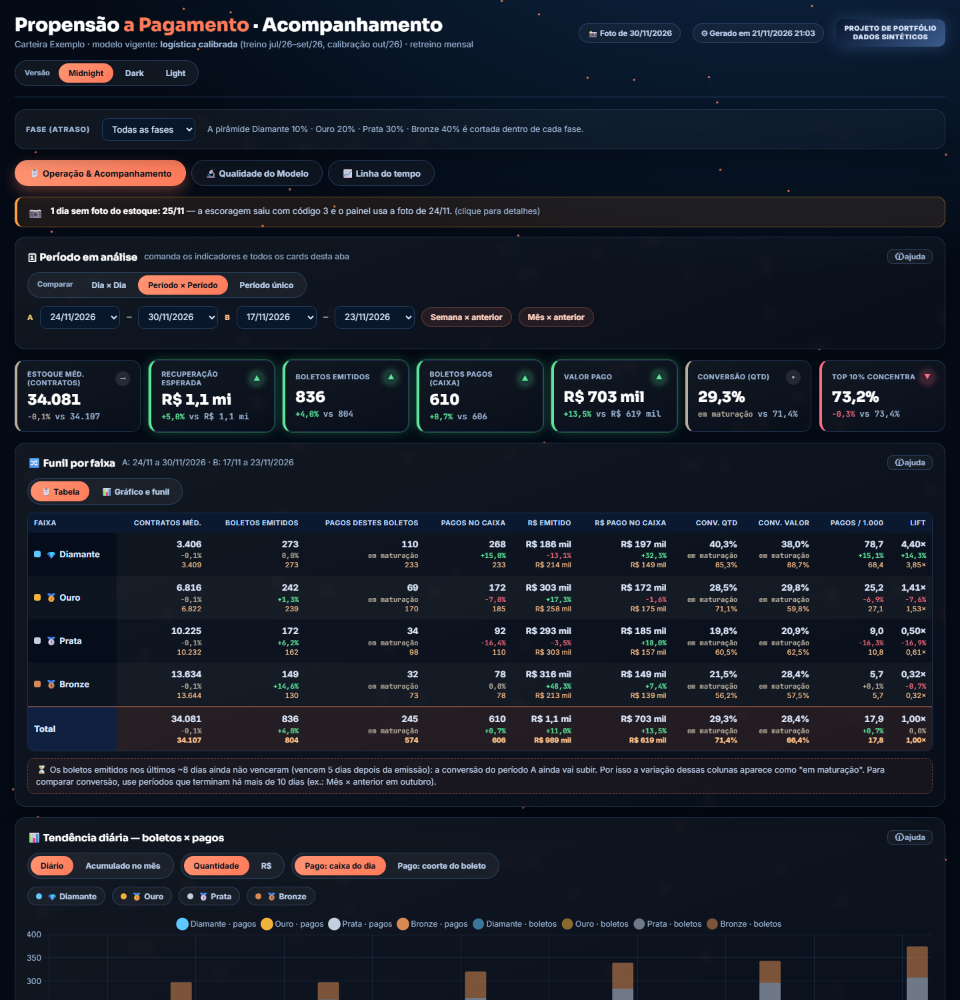
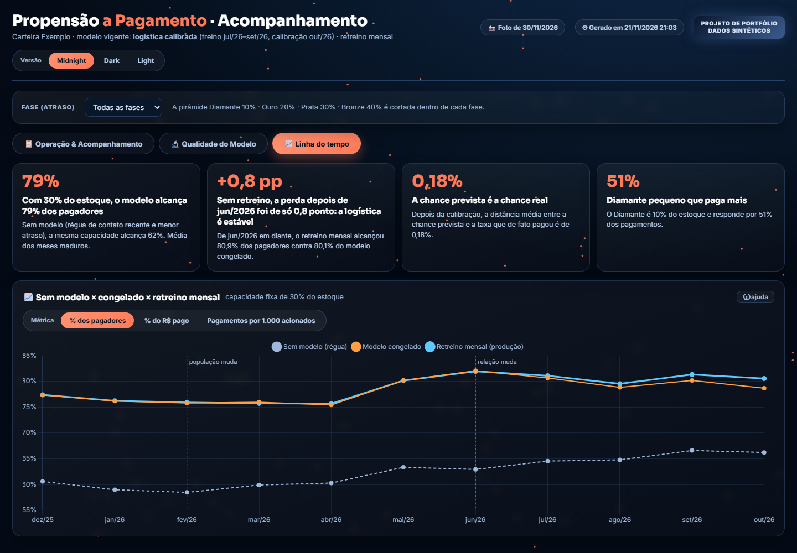

# Propensão a pagamento em cobrança

Modelo que ordena os contratos de uma carteira de cobrança pela chance de pagar nos próximos 30 dias, e o **painel em que a operação usa esse modelo todo dia**:
- funil por faixa;
- fila de trabalho por **valor esperado**;
- simulador de capacidade;
- a aba que vigia o modelo em produção: calibração, backtest de produção, escada de candidatos com gate, bateria de validação e explicação do score;
- a linha do tempo para a diretoria: sem modelo × congelado × retreino mensal;
- a escoragem diária com travas de produção (foto ausente, volume, hash do modelo, pirâmide, publicação atômica).

**▶ Abrir o painel:** https://Alajunior.github.io/propensao-pagamento-cobranca/ (abre no navegador, sem instalar nada; funciona no celular)
· [direto na Qualidade do Modelo](https://Alajunior.github.io/propensao-pagamento-cobranca/?aba=qualidade)
· [direto na Linha do tempo](https://Alajunior.github.io/propensao-pagamento-cobranca/?aba=tempo)

> **Todos os dados são sintéticos**, gerados por [`dados/gerar_carteira.py`](dados/gerar_carteira.py) (100 mil clientes, seed 42). Nenhum dado real de cliente ou de empresa. O painel reproduz o funcionamento de um painel que construí e mantenho em produção; o código foi escrito do zero.



## Como usar (2 minutos)

1. **Fase (atraso), no topo:** filtra tudo por faixa de dias de atraso. A pirâmide Diamante 10% · Ouro 20% · Prata 30% · Bronze 40% é cortada **dentro de cada fase**.
2. **Operação & Acompanhamento:**
   - **Período em análise:** compare dia × dia, semana × semana, mês × mês ou veja um período único. A seleção comanda os 7 indicadores e todos os cards.
   - **Funil por faixa:** contratos → boletos → pagos, com conversão, pagos por 1.000 contratos e lift.
   - **Tendência diária:** boletos empilhados por faixa e linhas de pagos, em quantidade ou R$, pelo caixa do dia ou pela coorte do boleto.
   - **Concentração & simulador:** arraste a capacidade e veja quanto da recuperação esperada a fila captura. A linha verde mostra o que de fato foi pago.
   - **Perfil da faixa**, com o perfil típico de cada faixa, e **Detalhamento de contratos**: a fila nominal, com busca e os 2 motivos do score de cada contrato.
   - **Execução da escoragem:** o resultado das travas nos últimos dias. A foto de 25/11 "não chega" de propósito: o painel avisa no topo e usa a foto anterior.
3. **Qualidade do Modelo:**
   - backtest de produção por fase (troque entre **retreino mensal** e **congelado**);
   - previu × pagou (calibração);
   - lift por fase;
   - estabilidade semanal e inversões;
   - a escada de candidatos com o gate;
   - a bateria de validação (6 testes);
   - por que o modelo decide e "medir o sinal" de cada variável;
   - AUC e PSI no tempo.
4. **Linha do tempo:** 4 conclusões para a diretoria, com o número calculado, e o gráfico mês a mês dos 3 cenários.

Cada card tem um botão **ⓘ ajuda** com "o que é / como ler / atenção". Três temas (Midnight, Dark e Light); o fundo de partículas reage ao mouse.




## Problema de negócio

Uma assessoria recebe contratos inadimplentes e trabalha cada um por cerca de 180 dias. Tem mais contratos do que operadores, linhas e disparos.

**Pergunta:** em cada data de referência D, quais contratos da carteira têm mais chance de pagar algo até D + 30 dias, e por onde começar para trazer mais R$?

## O que tem por trás

| Parte | Como funciona | Onde |
|---|---|---|
| **Carteira sintética** | 100 mil clientes e 138 mil contratos, de jan/2025 a dez/2026, com acionamentos, acordos e parcelas. Sujeiras de propósito: UF bagunçada, nulos, duplicatas, data em texto. **Duas mudanças de cenário:** em fev/2026 entram clientes de renda menor (muda a população); em jun/2026 muda a relação entre renda, atraso e pagamento | [`dados/gerar_carteira.py`](dados/gerar_carteira.py) |
| **Base sem olhar o futuro** | As variáveis usam só eventos anteriores a D; o alvo fica em (D, D+30]. Há versão em SQL com teste de equivalência | [`src/base_analitica.py`](src/base_analitica.py), [`sql/base_analitica.sql`](sql/base_analitica.sql) |
| **Escoragem diária como em produção** | Cada dia útil é escorado pelo modelo **vigente naquele dia**: logística treinada nas 3 safras fechadas anteriores à de calibração. É o retreino mensal. Dia sem 30 dias de futuro fica "não maduro", e o alvo fica vazio, nunca zero | [`src/escoragem.py`](src/escoragem.py) |
| **Calibração** | Isotônica **por fase**, ajustada numa safra que o modelo não viu no treino. Medida por Brier e ECE | [`src/calibracao.py`](src/calibracao.py) |
| **Valor esperado** | Chance calibrada × ticket típico da fase (mediana do que os pagadores pagaram ÷ dívida). **A faixa vem da chance; a fila vem do valor** | [`src/valor.py`](src/valor.py) |
| **Backtest de produção** | A faixa publicada em cada dia contra o pagamento real: ordenação perfeita / fraca / INVERTIDA / sem dados, inversões semanais, estabilidade e lift por fase | [`src/qualidade.py`](src/qualidade.py) |
| **Escada com gate** | Régua (sem modelo) → logística → LightGBM. O desafiante só substitui o campeão se ganhar em R$ no top 10% com IC bootstrap acima de zero, sem piorar nenhuma fase e sem inverter faixa | [`src/candidatos.py`](src/candidatos.py) |
| **Backtest fora do tempo e PSI** | Congelado × retreino mensal, safra a safra, com PSI do score e das variáveis. A validação interna separa treino e validação **por cliente** | [`src/backtest.py`](src/backtest.py), [`src/avaliar.py`](src/avaliar.py) |
| **Bateria de validação** | Seis testes com veredito ok / atenção / falhou: fora do tempo, aleatória × por cliente, alvo embaralhado, treino × teste, curva de aprendizado e IC bootstrap | [`src/validacao.py`](src/validacao.py) |
| **Sinal e explicação** | Cada variável sozinha contra o acaso e contra o modelo; contribuição **exata** da logística (coeficiente × desvio, sem SHAP); os 2 motivos de cada contrato; o perfil típico de cada faixa | [`src/sinal.py`](src/sinal.py) |
| **Linha do tempo** | Sem modelo × congelado × retreino mensal, mês a mês, com 30% de capacidade. Os títulos das conclusões saem dos números | [`src/linha_tempo.py`](src/linha_tempo.py) |
| **Travas de produção** | Escoragem diária com código de saída: 7 dia passado, 5 hash do modelo diferente do manifest, 3 foto ausente, 4 volume abaixo de 85%, 6 pirâmide fora. Publicação atômica (arquivo temporário + `os.replace`); rodar duas vezes o mesmo dia não duplica | [`src/producao.py`](src/producao.py), [`dags/escoragem_diaria.py`](dags/escoragem_diaria.py) |
| **Painel** | O Python calcula tudo e grava **um HTML** com os dados embutidos. Front em HTML, CSS e JS puro, com Chart.js. Chave ausente no payload = card escondido, nunca card vazio | [`src/montar_painel.py`](src/montar_painel.py), [`src/painel.html`](src/painel.html) |

## Resultados

### 1. O score ordena, mas o número dele estava errado (e a calibração conserta)

A logística usa `class_weight="balanced"`, que ajuda a ordenar numa base desbalanceada (pagam ~4%), mas infla a probabilidade.

| | Score bruto | Calibrado |
|---|---|---|
| Chance média prevista (a real é 4,15%) | 34,4% | **4,14%** |
| Brier | 0,149 | **0,035** |
| ECE (distância média entre previsto e pago) | 30,2% | **0,18%** |

- **O decil de cima mostra o tamanho do erro:** o score bruto previa 86% e pagaram 23%; o calibrado prevê 24%.
- **A calibração não muda a ordem dentro da fase:** só coloca o número no lugar. Isso importa porque o valor esperado multiplica a chance pelo ticket, e uma chance 8 vezes maior distorce a fila.

### 2. Fila por valor esperado traz mais R$; fila por chance traz mais pagadores

Nos dias maduros, com capacidade para acionar parte do estoque:

| Capacidade | Fila por chance (pagadores · R$ pago) | Fila por valor esperado (pagadores · R$ pago) |
|---|---|---|
| 10% | 56,2% · 38,0% | 38,8% · **58,8%** |
| 20% | 70,6% · 56,5% | 59,1% · **75,2%** |
| 30% | 78,8% · 67,8% | 70,7% · **83,9%** |

- **Com 10% de capacidade, a fila por valor captura 21 pontos a mais do R$ pago** e alcança 17 pontos a menos de pagadores.
- **A escolha é de negócio:** se a meta é R$ recuperado, fila por valor; se é quantidade de acordos, fila por chance.
- **Por isso o painel separa as duas coisas:** a faixa (Diamante..Bronze) continua sendo cortada pela chance, porque é o que a ordenação promete; a fila de trabalho usa o valor.

### 3. Backtest de produção: as faixas publicadas se comportaram

Dias maduros de 01/12/2025 a 30/10/2026, com retreino mensal:

| Fase | AUC | Taxa Diamante | Taxa Bronze | Ordenação |
|---|---|---|---|---|
| 0001-0360 | 0,766 | 35,1% | 3,21% | perfeita |
| 0361-0720 | 0,800 | 24,8% | 1,40% | perfeita |
| 0721-1080 | 0,809 | 13,6% | 0,67% | perfeita |
| 1081+ | 0,817 | 12,5% | 0,50% | perfeita |
| **Todas** | **0,833** | **21,3%** | **1,39%** | **perfeita** |

- **Inversões existem, e o painel as mostra:** 16 semanas com a ordem quebrada, todas nas fases antigas (0721-1080 e 1081+).
- **Em 15 delas, a Prata passou o Ouro:** nessas fases as duas pagam perto de 1%, e uma semana basta para a ordem trocar. É ruído entre faixas quase iguais, não o modelo invertido: o Diamante nunca foi passado.
- **A regra de leitura:** inversão isolada entre faixas vizinhas é ruído; inversão persistente, ou envolvendo o Diamante, pede retreino.
- **"Diamante" não vale o mesmo entre fases:** o lift do Diamante vai de 4,2× a média da fase (atraso curto) a 6,3× (atraso antigo). O card de lift por fase existe para ninguém ler o Diamante como uma coisa só.

### 4. Escada de candidatos: o gate aprovou o desafiante, e ele vai para modo sombra

Safras de teste de dez/2025 a out/2026, cada candidato retreinado todo mês. **Captura** = % do R$ pago que fica nos 10% de maior score.

| Candidato | Captura no top 10% | AUC |
|---|---|---|
| Régua (sem modelo: contato recente, depois menor atraso) | 31,9% | 0,733 |
| Regressão logística | 38,0% | 0,835 |
| LightGBM | **39,5%** | **0,839** |

- **Logística contra régua:** +6,1 pp de captura (IC 95% de +4,5 a +7,6). Passou nos 4 critérios.
- **LightGBM contra logística:** +1,5 pp (IC 95% de +0,8 a +2,2), sem piorar nenhuma fase e sem inverter faixa. **Passou no gate.**
- **Decisão:** o LightGBM vira o novo campeão, mas **entra em modo sombra** (escora em paralelo, sem ir para a operação) antes de substituir a logística, que segue em produção no painel.
  - O ganho é real mas pequeno: 1,5 pp do R$ no topo. Ele precisa se confirmar na escoragem diária, nas faixas publicadas, e não só no backtest mensal.
- **Ressalva honesta:** o gerador sintético usa uma relação logística por trás, o que favorece a logística. Mesmo assim o LightGBM ganha no topo da fila. Em dado real, com interações que ninguém programou, a vantagem do GBM costuma ser maior.
  - **A versão anterior deste repositório, com uma base 5× menor, concluiu o contrário:** o LightGBM não ganhava. Com mais dados, a diferença saiu do ruído. É exatamente para isso que existe o intervalo de confiança no gate.

### 5. A validação não é a produção, e o PSI vê a mudança errada

| | Até mai/2026 | De jun a out/2026 |
|---|---|---|
| LightGBM congelado (AUC fora do tempo) | 0,821 | 0,840 |
| LightGBM com retreino mensal | 0,822 | 0,849 |

- **Depois da mudança de relação, o congelado fica de 0,6 a 1,1 ponto abaixo do retreinado.** A AUC de validação dele continua dizendo 0,810 o tempo todo.
- **O PSI da renda passa de 0,25 em jun/2026 e chega a 0,56:** é a mudança de **população** de fev/2026 se acumulando na carteira. Mesmo assim o modelo continuou ordenando bem, então esse alarme foi falso para o desempenho.
- **A mudança de relação, a que importa, não aparece em PSI nenhum:** o do score fica abaixo de 0,02 e o dos dias de atraso perto de zero.
- **Lição:** PSI alto manda investigar; quem manda retreinar é a queda de desempenho fora do tempo, que chega com 30 dias de atraso. O retreino mensal com janela curta é a defesa.

### 6. Três modelos ordenam parecido

Média das safras antes de jun/2026, com retreino mensal ([`relatorios/comparacao_modelos.csv`](relatorios/comparacao_modelos.csv)):

| Modelo | AUC | KS | PR-AUC | Captura de pagadores no top 20% | Treino (s) |
|---|---|---|---|---|---|
| LightGBM | 0,822 | 0,520 | **0,268** | 69,0% | 0,56 |
| Regressão logística | 0,822 | **0,524** | 0,240 | **69,6%** | **0,21** |
| MLP (rede neural) | 0,818 | 0,517 | 0,249 | 68,5% | 3,19 |

- **A rede neural não entra:** não ganha em nada e custa 15 vezes mais para treinar que a logística.
- **O que separa o LightGBM é o topo da fila:** a maior PR-AUC. É o que o gate mede em R$.

### 7. Bateria de validação: um vazamento que só o modelo flexível aproveitava

Janela de treino de mar a mai/2026, teste em jun/2026 (o primeiro mês da relação nova):

| Teste | Resultado | Veredito |
|---|---|---|
| Fora do tempo, safra a safra | AUC média 0,832 em 13 safras maduras; a pior, 0,813 (out/25) | ok |
| Validação aleatória × separada por cliente | o sorteio aleatório superestima a AUC em 0,7 ponto no LightGBM e 0,1 na logística | atenção |
| Alvo embaralhado | AUC 0,496 com o alvo sorteado (esperado 0,48 a 0,52) | ok |
| Treino × fora do tempo | 0,833 no treino e 0,857 em jun/2026: não decorou | ok |
| Curva de aprendizado | de 50% para 100% do treino a AUC não muda: platô | ok |
| IC bootstrap por cliente | AUC 0,857, IC 95% de 0,846 a 0,868 | atenção |

- **O vazamento:** as safras empilhadas repetem o mesmo contrato, e o mesmo cliente, mês a mês. Sorteando a validação ao acaso, o mesmo cliente cai no treino e na validação.
  - O LightGBM decora o cliente e a validação sai 0,7 ponto otimista; a logística quase não se beneficia (0,1).
- **A correção:** a validação interna (`_treinar`) passou a separar 70/30 **por cliente**. A AUC de validação do LightGBM congelado caiu de 0,815 para 0,810; a da logística praticamente não mudou (0,814 → 0,815).
- **Os dois "atenção" não são falhas.** O primeiro é o vazamento, já corrigido. O segundo diz que a AUC de um mês varia ±1 ponto só pelo acaso, e isso é o motivo de o gate exigir intervalo de confiança.

### 8. Por que o modelo decide: o Diamante é quem já tem acordo

- **Medir o sinal antes de modelar:** sozinhas, "já tem acordo" (AUC 0,751) e "promessas de pagamento" (0,749) são as variáveis mais fortes.
  - Cada uma põe cerca de 73% dos pagadores nos seus 40% do topo, contra 40% do acaso.
  - O modelo inteiro põe 85%.
- **Na logística vigente, os maiores pesos** são os dias de atraso, "já tem acordo" e "nunca teve contato certo". A flag de nulo é variável própria: somada aos dias sem contato, ela invertia o sentido do motivo.
- **A explicação é exata, sem SHAP:** na logística, log-odds = intercepto + Σ coeficiente × variável. Medida contra o contrato médio do treino, a contribuição de cada variável fecha o log-odds até a 6ª casa, e há teste para isso.
- **Os motivos de cada contrato** dizem o lado: "já tem acordo", "atraso menor", "contato certo recente". A operação lê o porquê em vez de um número.
- **Perfil típico:** 94% do Diamante já tem acordo, contra 0% do Bronze. O Diamante tem 18 dias medianos desde o último contato certo; o Bronze, 59.

### 9. Linha do tempo para a diretoria

Com 30% do estoque acionado por dia, média dos meses maduros (dez/2025 a out/2026):

| Cenário | % dos pagadores | % do R$ pago | Pagamentos por 1.000 acionados |
|---|---|---|---|
| Sem modelo (régua) | 62,4% | 63,2% | 86 |
| Modelo congelado | 78,3% | 65,9% | 108 |
| Retreino mensal (produção) | **78,7%** | **66,8%** | **109** |

- **O ganho de verdade é ter modelo:** +16 pontos de pagadores sobre a régua com a mesma capacidade.
- **Em R$ a diferença é bem menor** (+3,6 pontos), porque a régua já prioriza atraso curto, que concentra o valor. É mais um motivo para a fila por valor esperado.
- **O retreino mensal rende 0,8 ponto sobre o congelado de jun/2026 em diante:** a logística é estável. O retreino é o seguro contra a próxima mudança de relação, não um ganho grande neste dado.
- **Diamante pequeno que paga mais:** 10% do estoque e 51% dos pagamentos.

### 10. Travas de produção: melhor não publicar do que publicar errado

A escoragem diária (`src/producao.py`) confere, nesta ordem, antes de publicar:
1. **Dia passado (código 7):** nunca regrava um dia anterior ao último publicado.
2. **Hash do modelo (código 5):** o `modelo.pkl` precisa bater com o sha256 do `manifest.json`. O pickle só é aberto depois disso.
3. **Foto ausente (código 3):** a carteira do dia não chegou.
4. **Volume (código 4):** menos de 85% dos contratos do último dia publicado indica carga incompleta.
5. **Pirâmide (código 6):** alguma fase com faixa fora de ±1 ponto do alvo 10/20/30/40.

Com tudo ok, o arquivo do dia é gravado num temporário e trocado com `os.replace`, de forma atômica. O build do painel roda essas travas de verdade nos 6 últimos dias úteis, com a foto de 25/11 removida de propósito: a execução sai com código 3, o painel avisa no topo e segue com a foto de 24/11.

## Monitoramento e quando retreinar

| Sinal | Onde aparece | Ação |
|---|---|---|
| PSI de variável ou do score > 0,25 | AUC e PSI no tempo | **Investigar** o que mudou na carteira (política, mix, canal) |
| Faixa INVERTIDA persistente na mesma fase, ou envolvendo o Diamante | Backtest de produção e inversões | **Retreinar** e revisar as variáveis da fase |
| AUC fora do tempo com queda > 3 pontos por 2 safras | AUC no tempo | **Retreinar** com a janela mais recente |
| ECE subindo (previsto se afastando do pago) | Previu × pagou | **Recalibrar** na safra fechada mais recente |
| Desafiante passa no gate | Escada de candidatos | **Modo sombra**, depois troca |
| Escoragem com código diferente de 0 | Execução da escoragem e aviso no topo | **Não publica**; o painel segue com a última foto e a DAG tenta de novo |
| Validação aleatória muito acima da separada por cliente | Bateria de validação | **Corrigir o vazamento** antes de confiar na validação |

## Como rodar

```bash
pip install -r requirements.txt
python dados/gerar_carteira.py      # carteira sintética de 100 mil clientes (~12 s)
python -m src.treinar               # backtest, comparação, escada com gate, bateria de validação e relatorios/ (~2 min)
python -m src.montar_painel         # escoragem diária, travas, agregados e docs/index.html (~3 min; cache em dados/escoragem/)
python -m pytest                    # 81 testes
```

Para ver o painel, sirva a pasta `docs/` (por exemplo `python -m http.server --directory docs`) ou abra `docs/index.html`. A cada push na `main`, a CI roda o pipeline do zero numa base pequena, roda os testes e publica a pasta `docs/` no GitHub Pages.

Opcional: com `pip install mlflow`, o `src.treinar` registra cada modelo e modo no MLflow.

## Estrutura

```
dados/gerar_carteira.py      gerador sintético (24 meses, duas mudanças de cenário)
sql/base_analitica.sql       a base em SQL (estilo PostgreSQL, roda em SQLite)
src/base_analitica.py        base as-of por safra (nada do futuro)
src/modelos.py               logística, LightGBM e MLP no mesmo Pipeline
src/backtest.py              congelado × retreino mensal fora do tempo, PSI
src/escoragem.py             escoragem diária com o modelo vigente; boletos por parcela
src/calibracao.py            isotônica por fase, Brier, ECE, previu × pagou
src/valor.py                 ticket por fase, valor esperado, concentração, fila por valor
src/qualidade.py             backtest de produção: ordenação, inversões, estabilidade, lift
src/candidatos.py            escada régua → logística → LightGBM com gate e IC bootstrap
src/faixas.py                pirâmide Diamante/Ouro/Prata/Bronze dentro da fase
src/validacao.py             bateria de validação (6 testes com veredito)
src/sinal.py                 medir sinal, contribuição exata da logística, motivos, perfil típico
src/linha_tempo.py           sem modelo × congelado × retreino mensal, conclusões calculadas
src/producao.py              escoragem diária com travas e publicação atômica
src/montar_painel.py         monta o payload e grava o HTML
src/painel.html              o painel (HTML, CSS e JS puro; Chart.js; fundo em canvas)
src/treinar.py               orquestra o backtest, a comparação, a escada e a bateria
dags/escoragem_diaria.py     DAG do Airflow que chama as travas (retreino mensal + escoragem)
docs/                        o painel publicado e as imagens deste README
relatorios/                  tabelas e gráficos estáticos do backtest, veredito e validação
tests/                       81 testes: grão, futuro, SQL = Python, calibração, gate, validação, sinal, travas, painel, guarda de publicação
```

## Próximos passos

- **Modo sombra do LightGBM:** escorar em paralelo por um mês e trocar só se o ganho se repetir nas faixas publicadas.
- **Testes do JavaScript do painel:** um harness em Node para a agregação de períodos e os estados raros.
- **Parcela pela data:** inferir a parcela do pagamento pela data, não pela ordem. Hoje um pagamento descartado por valor inválido (~0,3%) desloca as parcelas seguintes.
- **Atualização ao vivo:** ler de um banco a cada dia em vez do gerador sintético.
